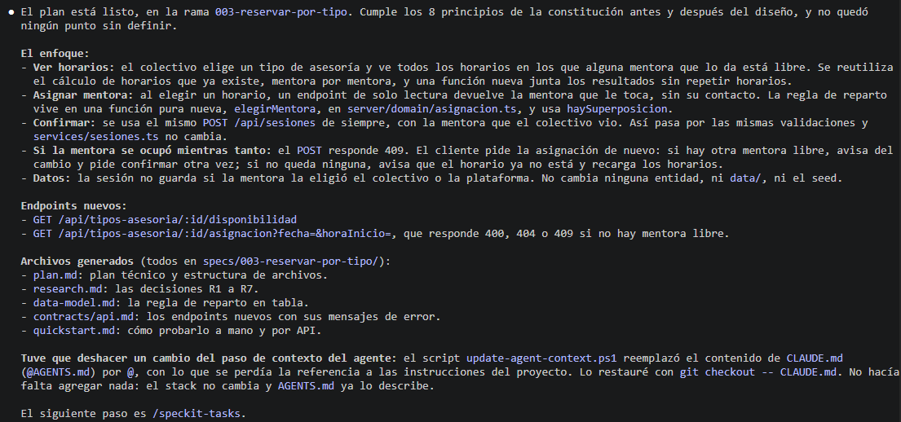

# Ejercicio 3 — Respuestas

**Historia elegida:** Cualquier mentora disponible
**Carpeta de la spec:** `specs/00X-...` <!-- la 001-reservar-sesion es el ejemplo; la tuya lleva el número que le ponga Spec Kit -->

**Nombre:** cevillalba
**¿Intervinieron durante la tarea?** _Sin completar en Mi perfil._

## Reflexión

### 1. Lo que generó el agente

_Sin responder._

### 2. Cada etapa

_Sin responder._

### 3. El método

_Sin responder._

### 4. SDD o prompt directo

_Sin responder._

### 5. Una skill para una etapa (opcional)

_Sin responder._

## Presentá tu trabajo

### 6. Resumen de la funcionalidad

_Sin responder._

## Para cerrar

**Modelo:** Opus 5.5

**Agente:** Claude

## Captura de pantalla

