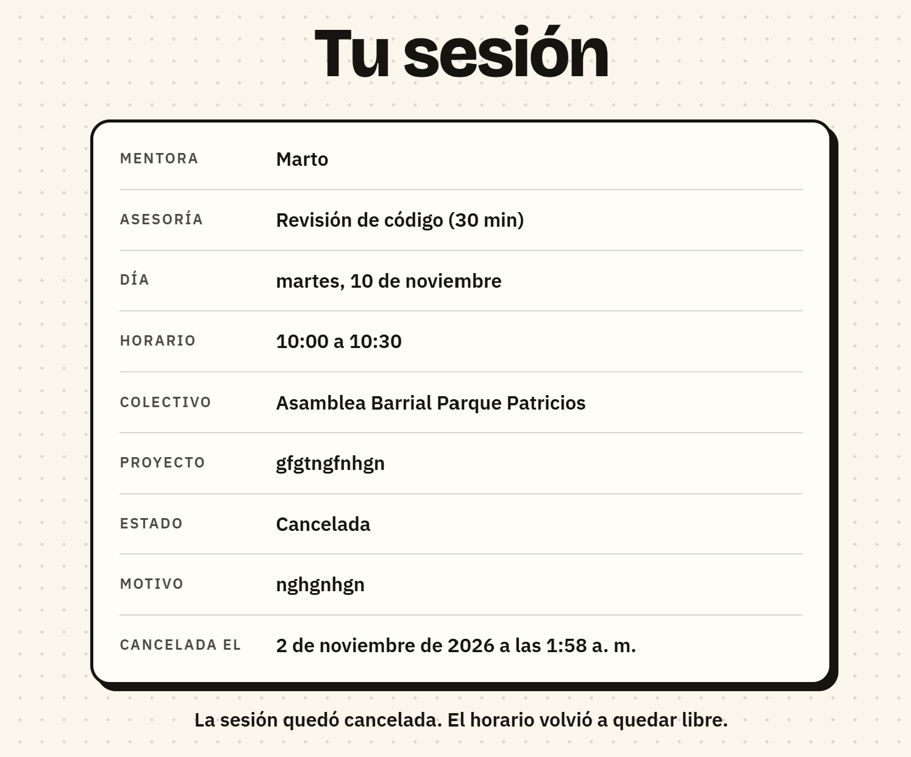

# Ejercicio 3 — Respuestas

**Historia elegida:** Cancelar una sesión
**Carpeta de la spec:** `specs/003-cancelar-sesion` (rama `004-cancelar-sesion`)

**Nombre:** _Sin completar en Mi perfil._
**¿Intervinieron durante la tarea?** _Sin completar en Mi perfil._

## Reflexión

### 1. Lo que generó el agente

En líneas generales, sí. La regla de las 24 horas es una función pura en server/domain/cancelacion.ts: recibe la sesión y "ahora" por parámetro y devuelve si se puede cancelar o por qué no (ya cancelada, ya ocurrió o fuera de plazo). El servicio busca la sesión, valida el cuerpo, evalúa la regla y recién ahí guarda; la ruta PATCH /api/sesiones/:id solo llama al servicio. En el cliente, SesionPage muestra el detalle, el enlace para copiar y el formulario de cancelación.

Lo que acepté sin terminar de entender es el código de React del final: cómo se borra la marca del historial con navigate(..., { replace: true, state: null }) y cómo se mueve el foco con useRef y useEffect. Sé qué problema resuelve cada uno y que tienen tests, pero no podría reescribirlos solo. Los tipos nuevos de shared/types.ts (Omit, uniones) también los leí por arriba.

### 2. Cada etapa

La más clara fue Specify: conté la historia en palabras normales y se convirtió en escenarios Dado/Cuando/Entonces y requisitos numerados. La que más me costó fue Plan: research, data-model y contracts son mucho texto técnico, y ahí apareció una decisión que no esperaba (sacar el id del listado público). La que más me sirvió fue Clarify: encontró que, si el colectivo cerraba /confirmacion sin copiar el enlace, nunca más podía cancelar, y por eso decidí que al reservar se vaya directo a la página de la sesión.

La que aprobé casi sin leer fue Tasks: eran 42 tareas y las revisé por fases y por los tests, no una por una. Para revisar entre etapas me apoyé en otro chat de Claude que me explicaba cada salida.

### 3. El método

Sí, sobre todo por las revisiones entre etapas. Un momento concreto: en Clarify decidí que alcanzaba con el enlace para cancelar, sin login. En Plan, el agente se dio cuenta de que el listado público GET /api/sesiones devolvía el id de todas las sesiones, o sea que cualquiera podía cancelar sesiones ajenas. Aprobé sacarlo del listado. Con un prompt directo, ese agujero probablemente habría llegado al código.

Dónde estorbó: Analyze encontró problemas reales (un test que iba a fallar porque Express devuelve 400 con JSON mal formado antes de buscar la sesión), pero el orden de tasks.md igual falló. En la fase 5, los tests del servidor ya pasaban porque la fase 4 había implementado ese comportamiento, así que no hubo rojo. El agente lo compensó rompiendo la regla a propósito para comprobar que el test fallaba. Además, un script de Spec Kit rompió CLAUDE.md y hubo que restaurarlo.

### 4. SDD o prompt directo

Para esta historia valió la pena, porque tenía decisiones de negocio abiertas (el límite de 24 h, contra qué hora comparar, cancelar sin login, quién ve el motivo) y cada una tenía consecuencias en otras partes: la seguridad del listado y la pantalla de confirmación. El costo fue alto: una historia "Chica" terminó en 42 tareas y 6 fases, y el agente agrandó el alcance por su cuenta (límite de 500 caracteres, confirmación antes de cancelar).

Usaría prompt directo para bugs acotados donde la regla ya está clara, como el de superposición del ejercicio 1. Usaría SDD para features nuevas con decisiones abiertas, o que cambian contratos de API o tocan privacidad.

### 5. Una skill para una etapa (opcional)

Elegiría Tasks, porque fue donde el método falló. Le pondría estos criterios: cada test tiene que poder fallar cuando se escribe, y si una fase anterior ya implementa ese comportamiento, el test va en esa fase; no marcar [P] tareas que tocan el mismo archivo; incluir npm run build en el cierre, porque la consigna lo pide y las tareas lo olvidaron; y en la prueba manual, regenerar los datos con npm run seed en vez de editar data/ a mano.

## Presentá tu trabajo

### 6. Resumen de la funcionalidad

Problema: un colectivo que reservaba una sesión no tenía forma de avisar que no iba, y el horario de la mentora quedaba ocupado.

Qué hice:
- Al reservar, el colectivo llega a /sesiones/:id, que reemplaza a /confirmacion. Esa dirección es su enlace: muestra el detalle sin datos de contacto, un botón para copiar y un aviso para guardarlo.
- Desde el enlace puede cancelar con un motivo opcional de hasta 500 caracteres (PATCH /api/sesiones/:id). GET /api/sesiones/:id avisa de antemano si se puede cancelar.
- La sesión cancelada libera su horario, que vuelve a ofrecerse.

Decisiones de negocio:
- Se puede cancelar hasta 24 h antes, con 24 h exactas incluidas. El inicio se toma en hora de Argentina y se compara con el momento real, sin depender de la zona del servidor.
- Alcanza con el enlace, sin login (el id es un UUID imposible de adivinar). Por eso se quitó el id del listado público GET /api/sesiones; cambia el contrato de la 001.
- El motivo solo se ve desde el enlace, porque la mentora todavía no tiene una vista.
- Si la sesión ya está cancelada o ya ocurrió, se responde 409 con un mensaje distinto y no se modifica nada.

Fuera de alcance: notificaciones, recuperar un enlace perdido y login. Deuda técnica: la reserva sigue usando la hora local del servidor.

Verificación: 438 tests con TDD; lint, typecheck y build sin errores; flujo recorrido con Playwright contra los escenarios de spec.md (13 verificados en el navegador, 2 cubiertos solo por tests).

## Para cerrar

**Modelo:** _Sin completar en Mi perfil._

**Agente:** _Sin completar en Mi perfil._

## Captura de pantalla

